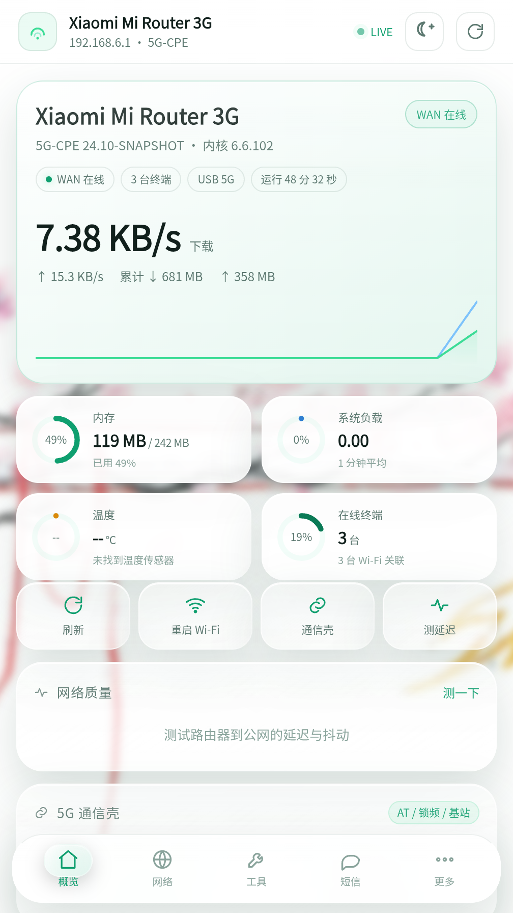
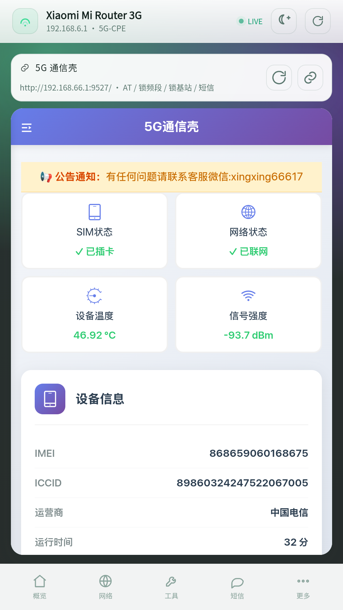

# 手搓CPE

> **代发说明**：本仓库为**代发**，非原作者本人维护。
>
> 仓库描述（原话照录）：
> **「手搓cpe软件 华为通讯壳5g➕小米路由器软件版，后续更新看情况 （本仓库为代发，原作者为酷安“大砖头没救了”）」**
>
> - 原作者：酷安 **「大砖头没救了」**（没有 GitHub 账号）；由 [bingshuang2014](https://github.com/bingshuang2014) 代为发布源码与 APK。
> - 仓库地址：<https://github.com/bingshuang2014/cep-master>
> - 后续更新看情况，代发者不承诺维护节奏；功能建议、问题反馈以原作者的酷安动态为准。
> - 代发只搬运源码与构建产物；发布前做过两轮独立源码审查，见「源码安全审查」。
>   发布后仅针对 sms-send 命令注入做过一处修复，**已发布的 v1.6.0 APK 仍是原作者成品、未重新打包**，
>   需要该受影响功能请自行构建 1.6.1，见「关于 1.6.1 与短信发送功能」。

一个给 **OpenWrt / 5G CPE** 手搓的手机管理端：原生 Android 壳 + 同款网页版。
深色 / 浅色 / 紫夜三主题，Liquid Glass（液态玻璃）卡片和悬浮底栏，DIY 壁纸，
内置 5G 通信壳后台（AT 命令、锁频段、锁基站、短信、温度、网络状态）。

> 适用于 192.168.6.1 这类 OpenWrt CPE（示例：Xiaomi Mi Router 3G / 5G-CPE 24.10）。
> 5G 通信壳页面来自模组自带的 Web 后台（示例：192.168.66.1:9527）。
> 请只在自己的局域网内使用，不要把这套面板暴露到公网。





## 功能

- **概览**：型号 / 固件 / 内核、WAN 实时速率曲线、累计流量、内存 / 负载 / 温度 /
  在线终端、上行链路、双频 SSID 和已连终端。
- **网络**：全部接口、IPv4/IPv6、DHCP 租约、Wi-Fi 终端信号（dBm / 速率）、
  接口流量、5G 模组信息。
- **工具**：定时重启（timedreboot）、断网看门狗（watchcat）、风扇、TurboACC
  （软件 / 硬件分载、SFE、FullCone、BBR）、UPnP / NAT-PMP、EQoS 限速、
  家长 / 时间控制开关、crontab 在线编辑、Wi-Fi 2.4G / 5G 信道锁定。
- **5G 通信壳**：App 内嵌 `http://192.168.66.1:9527`，实测可读 SIM 状态、
  网络状态、温度、信号强度、IMEI / ICCID / 运营商 / 运行时间 / 内存；
  侧边栏是 AT 命令、锁频段、锁基站、短信转发、流量控制、USB 模式等。
- **网络质量**：真实 ping 223.5.5.5，显示延迟、抖动、评级。
- **Liquid Glass**：半透明毛玻璃卡片、悬浮式底部导航、选中胶囊、壁纸透出。
- **三主题**：深色 / 浅色（Material）/ 紫夜（Argon），右上角一键切换并记忆。
- **DIY 壁纸**：4 张预设 + 相册自定义图片，支持模糊 / 暗度滑杆，只存本机。
- **App 和网页同一套 UI / 逻辑**。

## 网页版

需要 Node.js 18+（零 npm 依赖）：

```sh
cd web
node server.mjs
```

- 手机：`http://127.0.0.1:8090`（**不要**用 192.168.x，手机开移动数据时会被路由到 4G）
- 同一 WiFi 的电脑：`http://<手机 IP>:8090`

服务端把同源 `/ubus` 代理到路由器，解决 OpenWrt 的 CORS；并优先用
`curl --interface` 绑定 WiFi 出网卡。

## Android APK

目录 `android/` 是完整可重建的源码（**不需要 aapt**）：

- `app/src/com/dsh/cpepanel/MainActivity.java`：WebView 壳 + `CpeNative` JS 桥，
  每个 ubus 请求用 `Network.openConnection` 绑定 WiFi，允许混合内容以加载 5G 通信壳。
- `make-apk.mjs`：手写二进制 AndroidManifest（AXML）、`resources.arsc`、APK zip，
  并给 `resources.arsc` 做 4 字节对齐。
- `make-icon.mjs`：纯 Node 生成 192×192 图标（渐变圆角 + 路由器 + 信号波）。
- `build-apk.sh`：javac → d8 → make-apk → apksigner 一键构建。

构建示例（Linux / Termux，需 JDK、Android SDK 的 android.jar、d8 和 apksigner）：

```sh
cd android
export ANDROID_JAR=$ANDROID_HOME/platforms/android-33/android.jar
export PREFIX=/data/data/com.termux/files/usr   # Termux 可省略
./build-apk.sh
# 输出 android/app/build/app-signed.apk
```

首次构建会自动生成测试签名 `app/build/cpe.keystore`（密码 `cpepilot`）。
发版请自己保管好签名；公网仓库不要提交 keystore。

> 在 Android / Termux 上如果 `./build-apk.sh` 提示解释器不存在，直接运行
> `bash build-apk.sh`（脚本本身是标准 bash，可跨平台）。

## 目录

```
web/
  server.mjs        零依赖静态服务 + /ubus 代理
  start.sh
  public/
    index.html
    app.js
    style.css
    icon.svg
android/
  build-apk.sh
  make-apk.mjs
  make-icon.mjs
  AndroidManifest.xml
  app/src/com/dsh/cpepanel/MainActivity.java
docs/               截图与图标
```

## 已知限制

- 5G 通信壳页依赖模组/通信壳在线（示例 `192.168.66.1:9527`）；WAN 断开时该页会加载失败。
- 这台 CPE 的 UNISOC 模组只暴露 RNDIS，没有 AT 串口；**路由器本身**的锁频/AT
  由 5G 通信壳的 Web 后台完成，而不是在路由器上直接发 AT。
- 网页版的 5G 通信壳页是浏览器直连 `192.168.66.1`；手机开移动数据时可能被路由到 4G，
  建议用 App 版。
- 默认账号 root / root 只适合本地；请改密码，不要把 8090 映射到公网。
- `android/make-apk.mjs` 与 `android/make-icon.mjs` 用到 [`zlib.crc32()`](https://nodejs.org/docs/latest-v22.x/api/zlib.html#zlibcrc32data-value)
  （Node v22.2.0 / v20.15.0 起提供）；低于该版本重建 APK 会报 `zlib.crc32 is not a function`，
  **构建 APK 建议用 Node 22+**。网页版 `web/server.mjs` 不依赖它，Node 18+ 即可运行。

## 仓库

代发仓库：<https://github.com/bingshuang2014/cep-master>

```sh
git clone https://github.com/bingshuang2014/cep-master.git
cd cep-master
```

`web/`、`android/`、`docs/` 是源码，`LICENSE` 是 MIT 许可证。
`shoucou-cpe-source.tar.gz` 是源码归档，`ShouCou-CPE.apk` 是已签名安装包。

`.gitignore` 会忽略 `node_modules/`、`*.apk`、`*.keystore` / `*.jks`、`server.log`、
`android/app/build|assets|res/` 和 `*.tar.gz`——所以这两个二进制**不会**随 `git push` 上传，
发版时请用 GitHub Release 附件提供；本地这版的 SHA-256 见下节。

## 源码安全审查（代发时已完成）

发布前对**全部源码 + 预编译 APK + 源码归档**做了两轮独立静态审查（主审 + 独立复核，
结论一致），结论：

- **无恶意代码**：没有外联上报 / 遥测 / 隐藏 C2 域名或 IP，没有凭据外发、静默下载执行、
  后门、持久化、键盘记录、剪贴板或通讯录窃取，也不会在未经点击的情况下私自改路由器配置或发短信。
  全量枚举的网络目标只有内网（`192.168.6.1`、`192.168.66.1:9527`、`127.0.0.1:8090`）
  和公共 DNS `223.5.5.5`（仅 `ping -c 3/4` 测延迟与 watchcat 探测，ICMP 无数据回传）；
  Android 权限只有 `INTERNET` / `ACCESS_NETWORK_STATE`，无 `READ_SMS` / `SEND_SMS` /
  `READ_CONTACTS` / `RECEIVE_BOOT_COMPLETED`，无 Service / Receiver / Provider。
  登录密码只写进浏览器 `localStorage`（`app.js:552`），不下发到别处。
  唯一的定时任务是 `app.js:494-502` 的 `schedule()`（每 5 秒 `refresh()` 一次），
  `refresh()` 只发 `system.board`/`system.info`/`network.interface.dump`/`getDHCPLeases`/
  `luci.getOnlineUsers` 和 `SHELL_SCRIPT`（`app.js:278-302`，全是 `cat` / `uci -q get` /
  `ubus call` / `ls` 只读命令），**没有任何写操作或外发请求**。
  敏感操作（重启路由器、重启 Wi-Fi、重新拨号、改 UCI、写 crontab、发短信）全部挂在
  `app.js:1428` 的 click 事件里、经显式按钮 / 确认弹窗触发，没有自动触发路径。
- **无加密、无混淆、无加壳**：源码是明文 JS / Java / Shell；`classes.dex` 里类名、方法名、
  字符串全部可读（DEX 尾部只有 `~~D8` 标记，没开 R8/ProGuard/minify），APK 内只有一个 dex、
  没有 `.so`、没有额外 dex 或加密资源，DEX 的 sha1 / adler32 与头一致、未被二次篡改。
  出现的二进制/编码操作只有：PNG 生成（`deflateSync`）、APK zip 打包（`zlib.crc32`，store 模式）、
  AXML 与 `resources.arsc` 二进制构造、壁纸 `toDataURL`——
  这些是编码 / 压缩 / 签名，不是加密；也没有 `eval`、`atob`、base64 解码执行、动态加载、
  ≥120 字符的 base64 / hex 长字面量。
- **产物与源码一致（审查当时）**：APK 内 `assets/app.js`、`index.html`、`style.css`、
  `icon.svg` 与仓库源码逐文件 SHA-256 相同，`res/mipmap/ic_launcher.png` 与 `docs/icon.png` 全同，
  APK 共 11 个条目、无多余文件。`shoucou-cpe-source.tar.gz` 解出 20 个普通文件（无符号链接 /
  设备节点 / 绝对路径 / `..`），**补代发说明之前**与工作区源码逐文件 SHA-256 全同；
  补完说明后 17 个代码 / 脚本 / 图片仍逐字节一致，仅 3 份 README（根目录、`web/`、`android/`）
  与归档里的原版有纯文字差异（代发说明、仓库地址、Node 版本要求）——
  **发布时代码 / 脚本 / 图片零改动**，归档内保留 README 原版、未重新打包。
  **发布后**仓库源码只改了 `web/public/app.js` 一行（修复 sms-send 命令注入，见下节），
  因此当前仓库的 `app.js` 与 v1.6.0 APK 内的 `assets/app.js` / 归档里的原版**不再字节一致**；
  这是审查结论之后的明确修复，其余 16 个代码 / 脚本 / 图片仍逐字节一致。
  4 张 `docs/*.png` 都是标准 PNG（CRC 全对、IEND 之后 0 字节追加、无非标准 chunk，
  IDAT 解压后无像素余量）；源码里没有零宽字符 / 隐形 Unicode 控制符，无 NTFS 附加流。
- APK 签名：v1 + v2 + v3（`META-INF/CPE.SF` 带 `X-Android-APK-Signed: 2, 3`；
  Signing Block 第三个 pair 是 apksigner 的对齐 padding，不是 source-stamp），
  证书 `CN=CPE Pilot, O=CPE, C=CN`（自签，SHA384withRSA / 2048-bit RSA，
  SHA-1 `C9:27:FB:1C:AE:3D:78:9E:88:B5:2D:4B:8C:A0:0E:6C:94:D1:C5:B0`），
  有效期 2026/10/31 – 2054/03/18；`jarsigner -verify` 8 个条目全部验签通过，逐条 digest 复算一致。
  注意 `build-apk.sh:46` 自动生成的测试证书是 `CN=ShouCou CPE`，与发布 APK 的证书不是同一把；
  仓库里没有发布用的 keystore，自己重建的 APK 签名不同，覆盖安装需先卸载。
- 文档与实包的一处小差异：`android/AndroidManifest.xml`（文本参考，L23 有
  `android:windowSoftInputMode="adjustResize"`）与 `make-apk.mjs:38-72` 手写进 APK 的 AXML
  功能等价但非同一份表示，AXML 里没写 `windowSoftInputMode`。不影响功能，不是夹带。

校验值：

| 文件 | SHA-256 |
| --- | --- |
| `ShouCou-CPE.apk` | `79f83e4247d4604b167694d165a794ee2723a3212c7c375c47634f5016bfc62a` |
| `shoucou-cpe-source.tar.gz` | `7e0c8df74ef1cde4044e2e5c3d81d98287baf07492da6e798eb4550150619907` |

安装包按作者给的版本号发布在 Release `v1.6.0`，显示名（label）为 **`手搓CPE_1.6.0.apk`**；
GitHub 会把 asset 下载名里的 CJK 前缀剥掉，实际下载文件名为 `CPE_1.6.0.apk`，两者是同一个
156358 字节文件。它是仓库里 `ShouCou-CPE.apk` 的逐字节副本（SHA-256 相同，未重新签名），
APK 内 `versionName=1.6.0` / `versionCode=2`，`classes.dex` 带 D8 release 标记、AXML 无
`android:debuggable`，v1+v2+v3 签名有效（`MANIFEST.MF` 8 条摘要逐条复算通过）。
`shoucou-cpe-source.tar.gz` 作为源码归档一并附上。

## 关于 1.6.1 与短信发送功能

**已发布的 v1.6.0 成品含一个命令注入弱点**：`web/public/app.js:1729` 的「发送短信」把号码和内容
用 `JSON.stringify()` 拼进 `/bin/sh -c`，双引号挡不住 `$()` / 反引号的命令替换，输入会被路由器
当成命令执行（详见下方「命令注入面」）。这个功能只在检测到 `/dev/ttyUSB*` AT 串口时才出现，
而本 CPE 的 UNISOC 模组只暴露 RNDIS、没有 AT 串口（见「已知限制」），所以作者这台机器上
该页显示「未检测到」、按钮不会渲染；但装了 USB 串口驱动或换 QMI/MBIM 后即可达。

代发者已在**仓库源码**里修好这一行（改走现成的 `shq()` 单引号转义），并把构建版本号提到
**1.6.1 / versionCode=3**（`android/make-apk.mjs:41-42`、`android/AndroidManifest.xml:4-5`）。

> **Release 里的 `CPE_1.6.0.apk` 是原作者成品，未重新打包、未重新签名**（SHA-256 仍是
> `79f83e42…c62a`），它内部仍是未修的旧 `app.js`。要**用短信发送功能**，请按下面的步骤
> 自行构建 1.6.1，不要直接用 v1.6.0 的 APK。

```sh
cd android
export ANDROID_JAR=$ANDROID_HOME/platforms/android-33/android.jar
# Termux 上按实际路径设置 D8_JAR / APKSIGNER_JAR，见 android/README.md
./build-apk.sh        # 输出 android/app/build/app-signed.apk（versionName=1.6.1）
```

构建需要 JDK、`android.jar`、`d8.jar`、`apksigner.jar` 和 Node 22+（见「Android APK」与
`android/README.md`）。`build-apk.sh` 会用 `app/build/cpe.keystore` 重新签名，与发布证书不同，
**覆盖安装前需先卸载 v1.6.0**。网页版不受影响：直接 `node web/server.mjs` 跑的就是已修的源码，
无需构建，也无需 1.6.1 版本号。

其余功能、校验值、审查结论均对应 v1.6.0 成品；`shoucou-cpe-source.tar.gz` 归档保留的也是
发布时的原版源码（不含这处修复）。

需要留意的安全弱点（属于本地面板的历史设计，不是后门；按影响排序；v1.6.0 成品适用）：

**命令注入面（最值得修）**

- `app.js:1729` sms-send 把 `JSON.stringify(to)` / `JSON.stringify(body)` 直接拼进
  `/bin/sh -c`：JSON.stringify 不转义 `$()` 与反引号，双引号里的命令替换照样被 shell 执行，
  构成**路由器侧命令注入**。实测 `sh -c 'printf %s "x$(id)"'` 输出 `xuid=197609(admin)...`。
  对照 `app.js:1702` crontab 用 `shq()`（L126-128 单引号转义正确）、`app.js:1627` watchcat 与
  `app.js:1711` at-send 用白名单正则，那几处相对受控。**仓库源码已修**：该行改为
  `shq(dev) + " send " + shq(to) + " " + shq(body)`（构建版本 1.6.1）；
  但 **v1.6.0 成品 APK 内仍是旧代码**，要用此功能请自行构建 1.6.1，见上节。

**WebView / App**

- `MainActivity.java:48` 无条件开着 `WebView.setWebContentsDebuggingEnabled(true)`。
- `MainActivity.java:54-56` 混合内容允许 + `setAllowUniversalAccessFromFileURLs(true)` + 文件访问，
  `:86` 用 `addJavascriptInterface` 暴露 `CpeNative.ubus`；`:61-70` `shouldOverrideUrlLoading`
  一律 `return false` 且无 host 白名单 → LuCI / 通信壳 / 任何被导航到的 http(s) 页面都在同一
  WebView 内、都持有该桥。只应加载内置 assets，不要把 App 指向不可信页面。
  `targetSdk 27`（`AndroidManifest.xml:7`）使明文 HTTP 与旧式 WebView 行为可用。
- `MainActivity.java:151` 原生侧 `new URL("http://"+router+"/ubus")` 的 `router` 由 JS 传入，
  **没有** `server.mjs:37-56` 那样的内网白名单；明文 HTTP、目标可由页面控制。
  `:136-138` `evaluateJavascript` 用 `JSONObject.quote` 拼接，注入防护本身是对的。

**网关 / 服务端**

- `server.mjs:23` 默认监听 `0.0.0.0:8090`；`/ubus` 代理（L205-211）与 `/healthz`（L199-204）
  **都无鉴权**，同网段任何人可借该代理打路由器 /ubus 并读到默认路由器与 uptime。
- `server.mjs:44` `isPrivateHost` 放行 `169.254.0.0/16`（`a===169 && b===254`），
  含云元数据 `169.254.169.254`，有 SSRF 面；L50 正则还允许任意端口与 `127.0.0.1:PORT`
  （仅 path 被强制成 `/ubus`、query 清空）。L175-178 已挡目录穿越。
- `server.mjs:117` `CPE_CURL` 环境变量可指定 curl 可执行文件；但 `:120` `spawn` 用参数数组，
  没有 shell 拼接。`web/start.sh:11` 是常驻后台监听，用户手动运行才生效。

**凭据 / 渲染**

- `app.js:304` 通过 ubus `file.exec` 在路由器上跑 `/bin/sh`，工具页命令由前端拼接；
  默认 `root/root`（L35-36）+ 勾选记住密码后明文存 `localStorage`（L552）+ 开机自动重连
  （L1746-1750），等价于把路由器 root shell 交给能用这个页面的人。
- `app.js:1391` 用 `innerHTML` 渲染，字段靠 `esc()`（L130-131）转义，`openSheet()` 的
  `bodyHtml` 是内部常量，当前无注入点；但数据源含路由器可控的 DHCP hostname（L371）、
  SSID（L432-433）、`logread`（L1569）、诊断输出（L1579），属结构性 XSS 面。
  `style.css` 全量扫过：无 `url()` / `@import` / `expression` / `javascript:` / `data:` / 长 base64。
- `app.js:1175` iframe 明文加载通信壳并 `allow="clipboard-write"`；L1484/L1511/L1519
  `location.href`、L1485/L1512/L1520 `window.open` 指向未校验的 `state.router`。

## License

MIT
